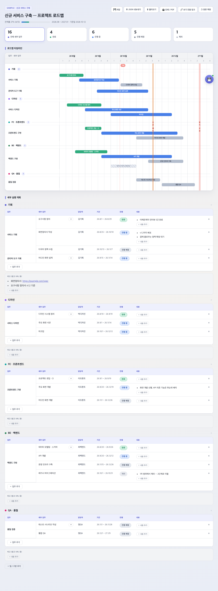

# 이우백두 21기 종산식 준비 로드맵

이우백두 21기 백두대간 종주 마무리 행사(종산제 · 종산식) 준비 일정을 관리하는 간트 로드맵.

- 보기: https://bebop14.github.io/baekdu21-closing/
- 보기 전용: https://bebop14.github.io/baekdu21-closing/?view=1
- 데이터: [`data/closing.json`](data/closing.json)
- 예상 일정(가안): 종산제 2026-12-12 · 종산식 2026-12-19 — 확정되면 기간을 다시 역산한다

화면에서 수정한 뒤 **⬇ JSON 내보내기** → `data/closing.json` 교체 → 커밋하면 반영된다.
주간 갱신은 `prompts/update-roadmap.md` 를 사용한다.

---

# Project Roadmap Template

프로젝트 일정(간트 + 세부 실행 계획)을 **JSON 한 개**로 관리하고, 브라우저에서 바로 편집하는 정적 템플릿.
GitHub Pages·사내 위키·단일 HTML 파일 어디에든 올라간다.



## 무엇이 들어있나

| 파일 | 역할 |
|---|---|
| `index.html` | 렌더러 + 에디터 (의존성 없음, 단일 파일) |
| `data/project.json` | 일정 데이터 — **여기만 고치면 된다** |
| `prompts/create-roadmap.md` | 기획서·회의록 → `project.json` 생성 프롬프트 |
| `prompts/update-roadmap.md` | 주간 진행상황 → 로드맵 갱신 프롬프트 |
| `build.py` | 단일 HTML / 위키 임베드 조각 빌드 |
| `publish_confluence.py` | Confluence 페이지로 발행 (사내용) |

## 기능

- **간트 타임라인** — 월/주 그리드, 오늘 표시선, 마일스톤 밴드, 월·주 헤더 hover 시 해당 구간 강조
- **세부 실행 계획 표** — 담당자·기간·상태·메모를 표에서 바로 편집
- **상태 뱃지 클릭** 으로 `진행 예정 → 진행 중 → 완료 → 제외` 순환, 간트 막대 색이 즉시 따라감
- **KPI 타일 클릭** 으로 상태 필터링, 진척률 자동 계산 (제외 항목은 분모에서 빠짐)
- 기간 칸에 `9/1 ~ 11/30` 또는 `2026-09-01 ~ 2026-11-30` 입력 → 막대가 그 자리로 이동
- **JSON 내보내기 / 불러오기**, 드래그 앤 드롭, 보기 전용 링크, 인쇄·PDF
- 편집 내용은 브라우저에 자동 보관 (팀 공유는 JSON 내보내기 → 커밋)

## 시작하기

```bash
git clone <this-repo> && cd project-roadmap-template
python3 -m http.server 8787        # file:// 로 열면 fetch 가 막히므로 로컬 서버 필요
open http://localhost:8787
```

### 새 프로젝트 추가

1. `prompts/create-roadmap.md` 를 Claude에 붙여넣고 기획서·회의록을 입력 → JSON 획득
2. `data/myproject.json` 으로 저장
3. `http://localhost:8787/?data=data/myproject.json` 으로 접속

`?data=` 로 프로젝트를 전환하므로 하나의 배포본에 여러 프로젝트를 올릴 수 있다.

### URL 파라미터

| 파라미터 | 설명 |
|---|---|
| `?data=data/x.json` | 불러올 데이터 파일 |
| `?view=1` | 보기 전용 (편집 UI 숨김) — 공유용 |

## GitHub Pages 배포

Settings → Pages → Source: `Deploy from a branch` → `main` / `/ (root)`.
이후 `https://<user>.github.io/<repo>/?data=data/project.json` 으로 접속된다.

> 사내 프로젝트 일정은 public repo에 올리지 말 것. 템플릿만 공개하고
> 실제 `project.json` 은 사내 저장소나 위키에 두는 것을 권장한다.

## 단일 HTML / 사내 위키

```bash
# 메일 첨부·오프라인용 단일 파일 (데이터 인라인)
python3 build.py --data data/project.json --out dist/myproject

# Confluence 발행 — 위키 화면에서 편집하고 [위키에 저장]으로 팀 전체 공유
export CONFLUENCE_URL=https://wiki.navercorp.com CONFLUENCE_TOKEN=...
python3 publish_confluence.py --space '~YOURKEY' --title '프로젝트 로드맵' --data data/project.json
```

`publish_confluence.py` 는 페이지 ID를 HTML 안에 심어둔다. 그래서 위키에서 직접 고친 내용을
`💾 위키에 저장` 버튼으로 페이지 본문에 되쓸 수 있다 (REST `PUT`, 버전 충돌 시 1회 재시도).
`build.py --page-id <id>` 로 조각만 만들어 HTML 매크로에 직접 붙여넣어도 된다.

## 데이터 스키마

`data/schema.json` 참고. 핵심만 보면:

```jsonc
{
  "meta":  { "title": "...", "start": "2026-08", "end": "2027-01" },
  "teams": [{ "key": "FE", "name": "FE · 프론트엔드", "color": "#0ea5a4", "remarks": [] }],
  "tasks": [{ "id": "fe1", "team": "FE", "name": "프론트엔드 구현", "subs": [
    { "id": "fe1a", "name": "주요 화면 개발", "owner": "이프론트",
      "start": "2026-09-20", "end": "2026-12-19", "status": "progress", "notes": [] }
  ]}],
  "milestones": [{ "label": "정식 오픈", "date": "2027-01-15" }]
}
```

- **세부 업무(`subs`)가 기본 단위** — 간트 막대 1개 = 표 1행
- `status` 는 `plan` · `progress` · `done` · `skip` (한글 `예정`/`진행`/`완료`/`제외` 도 읽는다)
- `teams` 배열 순서 = 화면 표시 순서
- 범위에서 빠진 일은 지우지 말고 `skip` 으로 두면 이력이 남는다

## 라이선스

MIT
